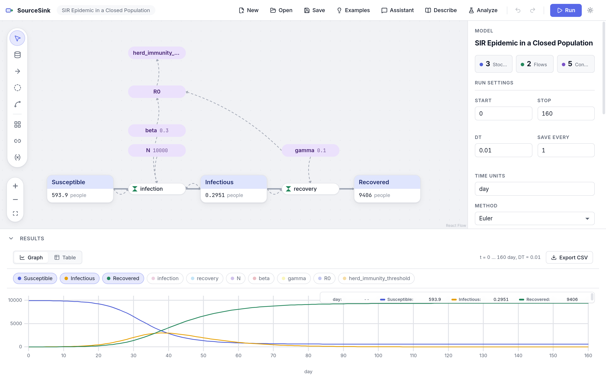

# SourceSink

SourceSink is an open-source system dynamics modeling tool. It runs as a desktop app on Linux, Windows and macOS, in the browser, and from the command line.

## Why this exists

Many of the systems engineers and scientists care about are accumulations that fill and drain over time. Oxygen in a river, nutrients in a lake, sediment behind a dam, and carbon in the atmosphere all behave this way. System dynamics gives us a simple visual language for these problems. Stocks hold things, flows move them, and converters carry the rules that connect them. A model drawn this way can be read by a student, a utility manager, or a regulator, and then simulated to see what happens next.

We think a modeling tool for teaching and research should be open. Students should be able to install it on any computer, models should be saved in a format anyone can read, and results should be reproducible by someone else. A model should also be testable against data, not only drawn and run.

**The objective of SourceSink is to provide a free, open, and modern place to build, run, calibrate, and explain stock-and-flow models.**

## A first look



The screenshot shows the classic SIR epidemic model (Kermack and McKendrick, 1927), one of the cited examples that ship with SourceSink. You can reproduce it in four steps:

1. Open **Examples** and choose **SIR epidemic** under Ecology.
2. Read the diagram. People move from **Susceptible** to **Infectious** through the *infection* flow (`beta * Susceptible * Infectious / N`) and on to **Recovered** through the *recovery* flow (`gamma * Infectious`). The converters hold the contact rate `beta = 0.3`, the recovery rate `gamma = 0.1` and the population `N = 10000`, so `R0 = beta / gamma = 3`.
3. Press **Run**. The results drawer plots the three stocks over 160 days. Infections peak near day 38 at about 3,000 people, and roughly 6% of the population is never infected.
4. Change `beta` or `gamma` in the inspector and run again to see how the peak moves. **Analyze** ranks which parameter matters most, and **Describe** explains the feedback loops in plain language.

The user manual walks through seven tutorials like this one, from building a first model to calibration and sensitivity analysis ([PDF](docs/manual/sourcesink-manual.pdf)).

## What you can do with it

1. **Draw and run models.** The editor provides stocks, flows, converters, connectors, and graphical functions on a canvas. Simulation uses Euler, Runge-Kutta 2 and 4, or adaptive Runge-Kutta 4/5. Arrays, scenarios, conveyors, queues, ovens, and more than 60 built-in functions (e.g., `SMTH1`, `DELAY3`, `PULSE`, `RANDOM`) are supported. SourceSink also checks units, so a flow in mg/L where the stock needs mg/L per day is flagged before it causes trouble.
2. **Use open, portable files.** Models are saved as XMILE, the open standard for system dynamics models. SourceSink can also import older models saved in the `.stm` and `.itm` formats.
3. **Fit a model to field data.** Load a CSV of observations and choose which parameters to estimate. SourceSink fits them and reports a standard error for each one. It also flags parameters that the data cannot tell apart.
4. **Find out which parameters matter.** Morris screening gives a quick ranking. Sobol indices then show how much of the output variance each parameter explains, with confidence intervals.
5. **See the range of outcomes.** Uncertainty runs sample the parameter ranges and plot the median with 25–75% and 5–95% bands.
6. **Describe a model in words.** The Describe view lists every stock, flow, and feedback loop in plain language, and checks that nothing in the model has been left out.
7. **Build a model by talking it through.** The Assistant asks what you want to know, what accumulates, and what fills and drains it, then drafts the model as a list of changes. You check each change before it is applied, and the assistant never touches the model without passing the validator first. It can also run the model to answer a question, such as when oxygen first falls below 5 mg/L, and it shows the runs it based the answer on. It then points you to the right next step (e.g., Calibrate when you mention field data). Language-model calls go through [OpenCode](https://opencode.ai) and OpenRouter, so you choose the model; a typical turn with DeepSeek Flash costs about a tenth of a cent.
8. **Script it, or let an AI assistant use it.** Everything in the app is also available from the `sourcesink` command line and through a Model Context Protocol (MCP) server. AI tools can only change a model through validated patches, which are checked and shown as a diff before anything is applied.

## Installing

You do not need to build anything. Each release on the [Releases page](https://github.com/TNAziz/sourcesink/releases) includes ready-to-run installers.

| System | Download | Notes |
|---|---|---|
| Linux (any distribution) | one command, below | Installs for your user only, no root needed |
| Debian, Ubuntu | `SourceSink-…-amd64.deb` | `sudo apt install ./SourceSink-…-amd64.deb` |
| Arch, Omarchy | `SourceSink-…-x64.pacman` | `sudo pacman -U SourceSink-…-x64.pacman` |
| Other Linux | `SourceSink-…-x86_64.AppImage` | Make it executable and run it (needs FUSE 2) |
| Windows | `SourceSink-…-x64.exe` | Windows may warn that the installer is unsigned; choose "Run anyway" |
| macOS | `SourceSink-…-arm64.dmg` or `-x64.dmg` | The app is not yet signed: the first time, right-click it and choose Open |

On Linux, this one command downloads the latest release and adds SourceSink to your app launcher:

```bash
curl -fsSL https://raw.githubusercontent.com/TNAziz/sourcesink/main/scripts/install.sh | sh
```

Run the same script with `--uninstall` to remove it.

The modeling assistant also needs [OpenCode](https://opencode.ai) signed in to OpenRouter. Everything else works without it.

## Building from source

You will need Node.js 22.19 or newer.

```bash
git clone https://github.com/TNAziz/sourcesink.git
cd sourcesink
npm install
npm start                  # the editor in your browser
npm run desktop            # or run the desktop app from source
npm run install:desktop    # build it and add SourceSink to your Linux app launcher
```

To publish a release, push a version tag (for example `git tag v0.2.0 && git push origin v0.2.0`). GitHub Actions then builds the Linux, Windows and macOS installers and attaches them to the release.

The example library is a good first stop. It holds 33 models in six groups: environmental engineering, business and management (e.g., Bass technology adoption, the rework cycle), natural resources and economics (e.g., an open-access fishery, Easter Island), climate and the Earth system (e.g., energy balance, Daisyworld, the Bern carbon pulse), populations and ecology, and short environmental problem-solving models in the spirit of Harte's *Consider a Spherical Cow*. Every model cites its source, and each is tested against the published or analytic result. Browse them under **Examples** in the app or in [`examples/README.md`](examples/README.md).

## Documentation

- **[User manual (PDF)](docs/manual/sourcesink-manual.pdf)**: seven worked tutorials, from building a first model to calibration, sensitivity analysis and the modeling assistant, with the mathematics behind each feature. The LaTeX source is in `docs/manual/`.
- **[Guide for AI agents and scripts](docs/llm/cli-guide.md)**: every command-line option, the model file format and the MCP server, written so a language model can use SourceSink without guessing. [`llms.txt`](llms.txt) points agents to it.
- **[Analysis guide](docs/analysis.md)**: calibration, identifiability, sensitivity and uncertainty in depth.

## A short example

The Streeter–Phelps model describes what happens to dissolved oxygen downstream of a waste discharge. Bacteria consume oxygen as they break down organic matter (the deoxygenation rate, `kd`). The atmosphere puts oxygen back (the reaeration rate, `ka`). The balance between the two sets how low the oxygen falls and when.

Suppose we have field measurements and want to know `kd` and `ka`. The repository includes a synthetic data set made with `kd = 0.35` and `ka = 0.55`, with noise and missing values added:

```bash
sourcesink fit examples/environmental/streeter-phelps.xmile \
  --data examples/environmental/streeter-phelps-observed.csv \
  --param kd=0.05:1 --param ka=0.05:2
```

```
Fitted parameters:
  kd        = 0.3463 ± 0.0023
  ka        = 0.5508 ± 0.0051
Objective: 0.42142
Evaluations: 69
Converged: yes

Series metrics:
  series      points    RMSE     NSE      R²     bias
  BOD             17  0.0428  0.9999       1  0.01176
  DO_deficit      21  0.1363   0.996  0.9963  0.03354
```

Both rates come back close to the true values, and the standard errors are small enough to trust them. Column headers such as `BOD (mg/L)` are matched to model elements automatically.

Next we can ask which parameter controls the worst oxygen deficit:

```bash
sourcesink sensitivity examples/environmental/streeter-phelps.xmile \
  --param kd=0.2:0.5 --param ka=0.4:0.8 --param DO_sat=8:10 \
  --metric DO_deficit:max
```

```
parameter         mu*          mu       sigma
kd             3.1758      3.1758     0.39732
ka             2.3328     -2.3328      0.4161
DO_sat              0           0           0
```

Faster oxygen demand deepens the sag and faster reaeration relieves it. Saturation concentration has no effect on the deficit at all, which is what the equations say it should do. The same steps are available in the app under **Analyze**, with charts.

If you are working from a source checkout, use `npx tsx src/cli/src/run.ts` in place of `sourcesink`. The full command list is `run`, `sweep`, `montecarlo`, `fit`, `sensitivity`, `explain`, and `convert`. The [analysis guide](docs/analysis.md) walks through calibration, identifiability, sensitivity, and uncertainty in detail.

## How the code is organized

SourceSink is a TypeScript workspace. Each package does one job.

| Package | What it does |
|---|---|
| `src/model` | The model representation, equation parser, and validation |
| `src/engine` | The simulation engine, a pure function of the model and run settings |
| `src/xmile` | XMILE reading and writing |
| `src/legacy` | The `.stm`/`.itm` importer |
| `src/analysis` | Ensembles, calibration, sensitivity, and uncertainty |
| `src/explain` | Causal links, feedback loops, and the structural description |
| `src/patch` | Validated model edits for people and AI tools |
| `src/assistant` | The conversational modeling assistant and its OpenCode bridge |
| `src/mcp` | The MCP server (`npm start -w @sourcesink/mcp`) |
| `src/cli` | The `sourcesink` command line |
| `src/ui` | The editor (React) |
| `src/desktop` | The Electron desktop app |

Run the tests with `npm test` and the type checker with `npm run typecheck`. Every behavior change comes with a test. In addition to the unit tests, `tests/corpus/` holds 43 models with known analytic answers and 22 deliberately broken models, so that we know the engine is right and the error messages are useful.

## Design principles

- **Open formats.** Models are plain XMILE files that other tools and people can read.
- **Tested against known answers.** The simulation engine is a pure function of the model and its run settings. More than a thousand tests check it, and every example model is checked against its published or analytic result.
- **Units matter.** Every equation is checked for dimensional consistency, because a unit mistake in a teaching model teaches the wrong thing.
- **AI assists, people decide.** The assistant can only propose changes. Each proposal passes the same validation as a hand-built model and is applied only when you accept it.

## Where it is headed

The roadmap is in [`docs/ROADMAP.md`](docs/ROADMAP.md), with detailed plans in [`docs/plans/`](docs/plans/). Next come design and policy analysis (comparing policies under uncertainty, then optimizing designs and tracing trade-offs), loop dominance analysis, which shows which feedback loop drives the behavior at each point in time, and Bayesian calibration. After that we plan a teaching layer built on the same foundations: predict-then-run exercises and a tutor that asks questions about the model in front of the student. The goal is not to have AI build models on its own, but to make it easier for a person to get from an idea to a model they understand and trust.

Some behavior is still inferred rather than confirmed. Oven settings in legacy files are the main example, and we will correct them if better reference outputs turn up. Bug reports and models that do not import correctly are very welcome.

## License

MIT. See [LICENSE](LICENSE).
